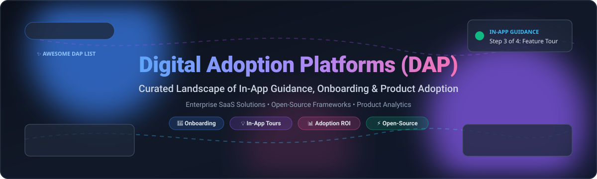

  

# 🚀 Awesome Digital Adoption Platform (DAP) 🌟

  
  
  
  
  

---

## 🧭 Curated Digital Adoption Platform (DAP) Ecosystem 💡

> **An authoritative, SEO-optimized directory of top SaaS digital adoption platforms and active open-source product tour, user onboarding, and contextual in-app guidance libraries.**

Digital Adoption Platforms (DAP) enable organizations, product-led growth (PLG) teams, customer success managers, and software engineers to guide users step-by-step through web, desktop, and mobile workflows. DAPs significantly reduce support ticket volume, maximize software feature adoption, accelerate new employee time-to-productivity, and deliver measurable ROI on corporate software investments.

---

## 📑 Table of Contents

- [📊 Sector Overview & Market Dynamics](#-sector-overview--market-dynamics)
- [🏢 SaaS/Hosted Platforms](#-saashosted-platforms)
- [🔓 Open-Source GitHub Projects](#-open-source-github-projects)
- [🛠️ DAP Architectural Blueprints](#️-dap-architectural-blueprints)
- [📈 Star History](#-star-history)
- [💖 Support & Sponsorship](#-support--sponsorship)
- [🤝 How to Contribute](#-how-to-contribute)
- [⚖️ Disclaimer](#️-disclaimer)

---

## 📊 Sector Overview & Market Dynamics

The global **Digital Adoption Platform (DAP)** market is estimated at approximately **$1.0B to $2.5B**, compounding aggressively at a **CAGR of ~17% to 23%** toward an anticipated **$4B to $12B+** over the next decade as cloud migration, AI co-pilots, and enterprise SaaS stack sprawl intensify. 

The sector is currently **moderately to highly fragmented** rather than winner-take-all:
- **Enterprise IT & Internal Workforce Enablement:** Heavyweights such as **WalkMe (SAP)**, **Whatfix**, and **Salesforce In-App Guidance** dominate complex multi-application employee training across ERP, CRM, and HCM stacks.
- **Product-Led Growth (PLG) & Customer Onboarding:** Agiler solutions like **Pendo**, **Appcues**, **Userpilot**, and **Chameleon** specialize in customer conversion, user activation, retention funnels, and in-product messaging.
- **Open-Source & Developer-First Infrastructure:** A rapidly expanding ecosystem of self-hosted, MIT/permissive libraries allows engineering teams to construct zero-vendor-lock-in guidance layers directly inside modern web applications.

---

## 🏢 SaaS/Hosted Platforms

The table below provides transparent, verified entry-level pricing tiers, exact free tier / trial terms, and estimated company scale (valuation / market capitalization / ARR), sorted in descending order of company size.

| Product | Valuation / Revenue (Company Size) 🌐 | Pricing (Starting Tier) 💳 | Free Tier / Trial Limits 🎁 | Key Highlights ⚡ |
| :--- | :--- | :--- | :--- | :--- |
| **[Salesforce In-App Guidance](https://help.salesforce.com/s/articleView?id=platform.customhelp_lex.htm&type=5)** | ~$200B+ Market Cap (Salesforce) / $41.5B Revenue | $25/user/month (Salesforce Enablement add-on for unlimited custom walkthroughs) | **Free forever tier included in Lightning editions:** Up to 3 active custom walkthroughs simultaneously across the org; unlimited pre-built AppExchange walkthroughs and single prompts. | Native Salesforce DAP for prompts, walkthroughs, and learning paths with Guidance Center and docked/floating prompts. |
| **[WalkMe](https://www.walkme.com/)** | $1.5B (Acquired by SAP) / ~$270M ARR | ~$35,000 to $50,000/year contract minimum (~$10–$35/user/month for mid-market) | **30-day free trial** (WalkMe Learning Arc AI course authoring and simulation tool, no credit card required); enterprise DAP requires sales demo / custom proof-of-concept. | Enterprise DAP and AI adoption platform now part of SAP, featuring DeepUI screen context, omnichannel Action Bar, and workflow automation. |
| **[Pendo](https://www.pendo.io/)** | $2.6B Valuation (Series F) / ~$200M+ ARR | ~$18,000/year contract starting baseline (Base Plan, quote-based by MAU) | **Free forever plan:** Capped at 500 Monthly Active Users (MAUs), includes core product analytics, in-app guides, and roadmaps with 12 months historical data. 30-day full trial available via sales. | Combines product analytics, in-app guides, session replay, and NPS surveys across customer-facing and employee software. |
| **[Whatfix](https://whatfix.com/)** | ~$900M Valuation (Series E) / ~$75M–$100M ARR | ~$31,950/year median contract entry (application-based + user tiers) | **No self-serve free tier; custom proof-of-concept / demo trial only:** Handled via sales qualification for 14 to 30 days during pilot deployment. | AI-native enterprise DAP with guided flows, ScreenSense™ AI, simulation training, and contextual task lists. |
| **[Spekit](https://spekit.com/)** | ~$350M Valuation (Series B) / $60M+ Total Funding | ~$16,300/year median contract entry (~$10–$18/user/month for 500+ seat enterprise deployments) | **No self-serve free tier or trial:** Requires guided sales demo and tailored enterprise pilot environment. | AI-powered enablement and DAP with AI Sidekick for just-in-time coaching, unifying DAP, KMS, and LMS capabilities with deep Salesforce/Slack integration. |
| **[Appcues](https://www.appcues.com/)** | ~$100M–$300M Est. Valuation / ~$15M–$17M ARR | $249/month (Essentials Plan, billed annually for up to 2,500 MAUs) | **14-day free trial:** Full access to build and publish flows, checklists, and experiences during evaluation without upfront contract. | No-code DAP for in-product onboarding, Builder Chrome extension, checklists, pins, banners, and multi-channel workflows. |
| **[Userlane](https://www.userlane.com/)** | ~$50M–$80M Est. Valuation ($16.2M Raised) / ~$15K–$18K Avg. ACV | ~$500/month ($6,000/year entry baseline for single-application setups) | **No self-serve free tier or trial:** Interactive proof-of-concept and guided sandbox available upon demo request with sales team. | Application Intelligence and Contextual Assistance with App Discovery for shadow IT, HEART Score adoption metrics, and MS Copilot integration. |
| **[Stonly](https://stonly.com/)** | ~$50M–$80M Est. Valuation ($25.5M Raised) / ~$11M ARR | $99/month (Small Business Starter Tier) | **Free forever Basic plan:** Up to 5 published guides, 400 guide views per month, 1 team member; includes initial **14-day free trial** of Small Business tier before downgrading to Basic. | Interactive product adoption platform with hotspots, tooltips, interactive guides, and multi-path user onboarding. |
| **[Userpilot](https://userpilot.com/)** | ~$40M–$60M Est. Valuation ($5.9M Raised) / ~$10M–$25M ARR | $299/month (Starter Plan, billed annually for up to 2,000 MAUs and 3 seats) | **14-day free trial:** Full access to Starter/Growth features with no credit card required upfront; no forever-free tier. | Product growth platform for onboarding, adoption, and monetization with AI Agent Lia, session replay, and NPS surveys. |
| **[Chameleon](https://www.chameleon.io/)** | ~$30M–$50M Est. Valuation ($14.9M Raised) / ~$5M–$10M ARR | $279/month (Startup Plan, billed annually for up to 2,000 MTUs and 10 live experiences) | **14-day free trial:** Access to build and test experiences across Pro/Growth capabilities without requiring an upfront credit card; no forever-free tier. | Deep product adoption platform with advanced element selection, on-page triggers, HelpBar, and custom experience styling. |

---

## 🔓 Open-Source GitHub Projects

Curated list of production-ready, open-source libraries, step-by-step tour engines, and onboarding frameworks for building self-hosted digital adoption platforms. Sorted in descending order of GitHub stargazers count:

- **[Driver.js](https://github.com/kamranahmedse/driver.js)**   
  *License: MIT* | *Zero Dependencies*  
  Lightweight, powerful, vanilla JavaScript engine to spotlight elements, drive user attention, and build interactive feature walkthroughs. Works seamlessly with vanilla JS, React, Vue, Angular, Svelte, and Next.js applications.

- **[Intro.js](https://github.com/usablica/intro.js)**   
  *License: AGPL-3.0 / Commercial*  
  The classic step-by-step user tour and onboarding library with rich keyboard navigation, progress bars, responsive hints, and multi-page tour capability.

- **[Shepherd.js](https://github.com/shipshapecode/shepherd)**   
  *License: MIT*  
  Enterprise-grade, highly accessible guide and tour library powered by Floating UI. Official integrations for React, Vue, Angular, Ember, Svelte, and Rails (`shepherd-rails`). Used in mission-critical applications like LogSeq, Drupal, and Budibase.

- **[React-Joyride](https://github.com/gilbarbara/react-joyride)**   
  *License: MIT*  
  The standard guided tour and beacon walkthrough component for React applications. Supports controlled tours, custom tooltips, scrolling automation, spot lighting, and flexible action callbacks.

- **[React-Native-Copilot](https://github.com/mohebifar/react-native-copilot)**   
  *License: MIT*  
  Step-by-step walkthrough and tooltip tour library for native mobile applications built with React Native (iOS & Android). Features smooth SVG masking, customizable coachmarks, and modal overlays.

- **[Vue Tour](https://github.com/pulsardev/vue-tour)**   
  *License: MIT*  
  Lightweight, customizable guided tour plugin built natively for Vue.js applications. Provides easy declarative tour step composition and custom styling options.

- **[Usertour](https://github.com/usertour/usertour)**   
  *License: AGPL-3.0*  
  Full-featured open-source user onboarding platform and self-hosted alternative to Appcues and Userflow. Create in-app product tours, multi-step checklists, feedback surveys, and user segmentation without code.

- **[Reactour](https://github.com/elrumordelaluz/reactour)**   
  *License: MIT*  
  Flexible, composable tour guide components for React applications with smooth SVG masking, customizable controls, keyboard bindings, and route-aware transitions.

- **[Onborda](https://github.com/uixmat/onborda)**   
  *License: MIT*  
  Modern product onboarding wizard and contextual tour framework designed for Next.js, powered by Framer Motion spring physics with modern UI styling.

- **[Bitmapist](https://github.com/Doist/bitmapist)**   
  *License: MIT*  
  High-performance real-time user cohort and feature adoption analytics engine built on Redis bitmaps. Used by Doist (Todoist, Twist) to track feature adoption, retention curves, and lifecycle metrics with 443x memory efficiency.

- **[TourGuide-JS](https://github.com/sjmc11/tourguide-js)**   
  *License: MIT*  
  Simple, lightweight vanilla JS tour guide and walkthrough library with zero external dependencies, mobile touch compatibility, and custom CSS variables.

- **[Modern Tour](https://github.com/thangdevalone/modern-tour)**   
  *License: MIT*  
  Lightweight React product tour library featuring spring physics animations via Framer Motion, dark mode support, and a headless `useTour` hook for custom UI rendering.

- **[OpenTutorial](https://github.com/JeanPaulDot/OpenTutorial)**   
  *License: MIT*  
  Spec-driven in-app guidance engine with multi-framework adapters (React, Vue 3, Svelte, Angular, Solid) and built-in dispatchers for event triggers and analytics connectors (PostHog, Mixpanel).

---

## 🛠️ DAP Architectural Blueprints

When building a self-hosted, vendor-independent Digital Adoption Platform, you can combine these modular open-source layers:

1. **Interaction & Tour Presentation Engine:** [Driver.js](https://github.com/kamranahmedse/driver.js), [Shepherd.js](https://github.com/shipshapecode/shepherd), or [React-Joyride](https://github.com/gilbarbara/react-joyride) for spotlights, modals, and tooltips.
2. **End-to-End Onboarding Management:** [Usertour](https://github.com/usertour/usertour) for no-code checklist builders, triggers, and survey displays.
3. **Behavioral Analytics & Cohorts:** [Bitmapist](https://github.com/Doist/bitmapist) paired with [PostHog](https://github.com/PostHog/posthog) for tracking feature drop-offs and onboarding completions.

---

# #  Star History

---

## 💖 Support & Sponsorship

If you find this curated digital adoption resource valuable for your team or project, please consider:
- ⭐ **Starring** the repository on GitHub to help others discover it.
- 🍴 **Forking** and submitting pull requests to enrich the entries.
- 📢 **Sharing** with your network, product managers, and developer communities.
- ☕ **Buying a Coffee / Sponsoring:** Support ongoing curation and maintenance via the [GitHub Sponsors Dashboard](https://github.com/sponsors/ishandutta2007).

---

## 🤝 How to Contribute

Contributions are warmly welcome! To add or update an entry:

1. 🍴 **Fork** the repository.
2. 📝 **Edit `README.md`** following the existing tabular or listing format.
3. 🔍 **Verify details**: Ensure descriptions are factual, pricing is verified, and repository links point to official sources.
4. 🚀 **Submit a Pull Request** with a clear explanation of changes.

---

## ⚖️ Disclaimer

- This is a community-curated collection intended for educational and architectural reference — inclusion does not constitute commercial endorsement.
- All trademarks, logos, and service names are property of their respective owners.
- Digital adoption platforms collecting end-user behavior data must strictly comply with regional data governance frameworks (GDPR, CCPA, HIPAA, SOC 2).

---

  <b>Built with ❤️ for product teams, customer success leaders, and software engineers worldwide.</b>

